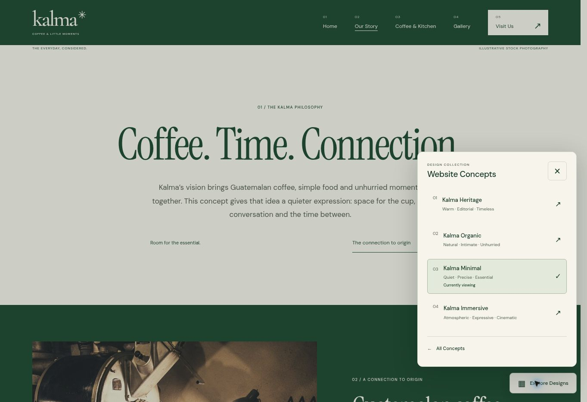

# Reusable concept switcher — Phase 5.1

Baseline: main `6524539621a84f30fab20bfa479cce150606fff3`, after merged PR #4. The four existing concept implementations are preserved.

## Architecture and reuse

- `src/data/presentation.ts` defines `WebsiteConcept` and the central `presentationConfig`.
- `src/data/concepts.ts` maps existing project metadata to switcher definitions. Names and routes stay outside interaction code.
- `src/components/presentation/ConceptSwitcher.astro` accepts `concepts: readonly WebsiteConcept[]`, optional `currentId`, `allConceptsHref` and unique `id`. If no current ID is supplied, it matches the current pathname, ignoring trailing slashes.
- `ConceptSwitcher.css` scopes the cream/forest-green presentation UI with `cs-` classes. It reuses the existing local DM Sans font.
- `src/scripts/concept-switcher.js` is a small framework-free ES module. The `.js` extension is intentional: Vite's `?url` emits a directly executable external asset rather than transpiling TypeScript. Typed component properties and centralized data provide the reusable contract.
- `BaseLayout.astro` mounts the component once, only on an enabled concept route. No concept-specific page, style, layout, image, navigation or footer source was changed.

For another client, supply a different concept array with stable IDs, display numbers, names, short descriptions, URLs and `available` booleans. There is no fixed concept count. Unavailable concepts render as noninteractive “Coming soon” entries. The panel scrolls when its contents exceed the available height. Change `allConceptsHref` if the overview lives elsewhere. Use one switcher per page; a custom `id` avoids collisions if composing a different presentation shell.

Set `presentationConfig.enabled` to `false`, or run `PRESENTATION_MODE=off npm run build`, to remove the complete component. Conditional external CSS/module references prevent browser requests for both supporting assets when disabled. The bundler may still emit unreferenced files; disabled pages do not load them. A rebuild is required. This is not authentication or access control.

## Interaction and accessibility

The enhanced control uses native `dialog.showModal()` at every width: a desktop floating panel and a mobile bottom sheet. Modal semantics are consistent, background content is inert, focus starts on the close button, and explicit Tab/Shift+Tab wrapping complements native dialog behavior. Escape, the close button and backdrop clicks dismiss the dialog; focus returns to the launcher. Links remain ordinary anchors. Scroll locking preserves existing inline styles and restores the original scroll position, including when leaving through a link or entering the browser back/forward cache.

Without JavaScript or native dialog support, a `details`/`summary` disclosure exposes the same links as a nonmodal popover. Its summary closes it; modal-only controls stay hidden. Reduced-motion preferences disable switcher animations and transitions. Focus outlines, active-page text and `aria-current="page"` supplement color indicators.

The floating control respects safe areas. A presentation-only 80px plus safe-area clearance region follows the existing footer, allowing its final links to scroll clear of the control. This is supporting switcher space; the concept footer markup and styling remain unchanged. Open sheets scroll internally, with touch targets of at least 44px.

## Verification

Commands: `npm run check`, `npm run build`, `npm test`.

The automated suite covers every static route, local assets, internal anchors, existing concept behaviors, switcher placement and links, current-page state, button/dialog relationships, and focus wrapping for 2, 3, 4 and 7 concepts. It also performs a separate real Astro build with presentation disabled and compares the underlying concept output against the enabled build after removing only the switcher subtree.

Browser automation in Chromium checked:

- Opening and closing, Escape, focus restoration, first/last Tab wrapping and native modal state.
- All four concept links and All Concepts, with correct active state after each navigation.
- Native no-JavaScript disclosure and navigation to Organic.
- Background scroll lock and exact restoration: desktop 900px and mobile 708px.
- Automated DOM geometry checks at 320, 390, 768, 1024 and 1440px frame widths: no horizontal overflow; open panel bounds remained inside the viewport. Mobile link targets were at least 48px; the close button is 44px.
- Visual review of the desktop panel and 390px mobile sheet.

Responsive checks used fixed-width browser frames with an 844px height, not physical devices. Safari/iOS, screen readers and OS safe-area insets were not tested on hardware. Native browser support and CSS safe-area handling are implemented, but this is not a formal accessibility audit.

Regression comparison against a separately built approved baseline confirmed that the existing four concept subtrees are unchanged after excluding only the new switcher and normalizing intertag whitespace. The selector, notice and 404 HTML were unchanged. All 53 baseline assets were byte-identical. Full concept pages intentionally differ because they now include presentation markup and supporting assets.

Cloudflare configuration, dependencies and production settings are unchanged. Publish only the feature branch; review through an unmerged PR into main and the existing `kalma-cafe` Worker preview.
